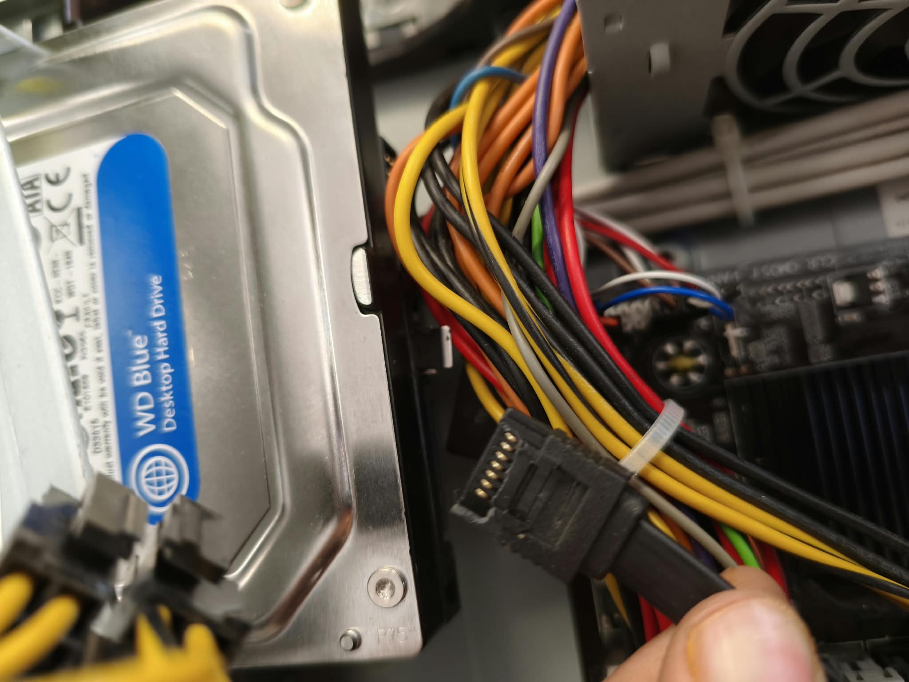
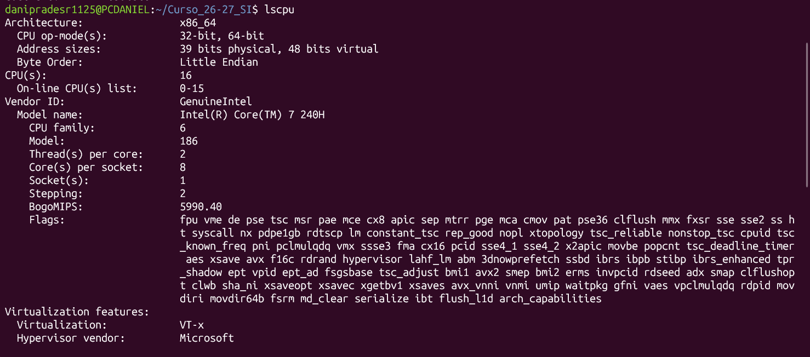
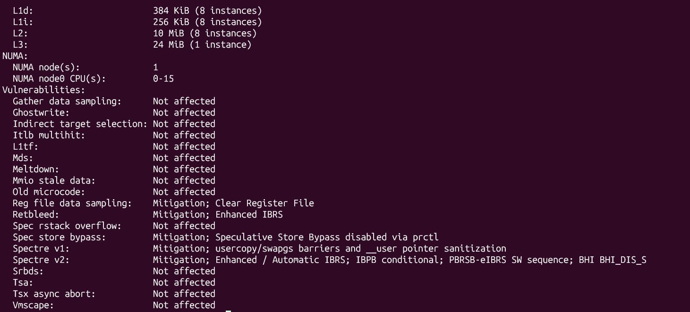
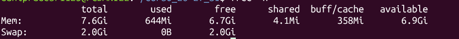
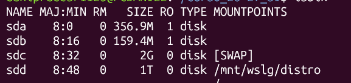
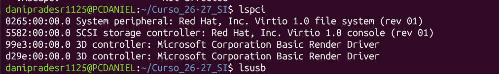

# SI · UT2 — Ficha de taller: montaje y revisión de un ordenador

## 1. Orden de trabajo

**Fecha:** 16/11/26  **Puesto:** ____________________  **Equipo / etiqueta:** ____________________

**Integrantes del grupo (2 o 3):**

1. Nombre y apellidos: Daniel Prades Remacho
2. Nombre y apellidos: Caleb Martín Cepero

> **Equipo A:** ordenador de prácticas utilizado para el montaje o la revisión. Puede estar averiado; no se exige que arranque.
>
> **Equipo B:** vuestro propio ordenador funcional. Se utiliza a partir del apartado 9 para analizar el arranque y el hardware desde Linux.

## 2. Recepción e inspección visual · Equipo A

**Trabajo previsto:**

- [x] Desmontaje y montaje
- [x] Revisión / diagnóstico
- [ ] Otro: ___________________________________

**Estado al recibirlo:**

- [x] Completo
- [ ] Faltan piezas
- [x] Sucio
- [ ] Daños visibles

**Síntomas conocidos, piezas ausentes o daños observados:**

________________________________________________________________________

________________________________________________________________________

## 3. Seguridad y preparación · Equipo A

- [x] Equipo desconectado de la corriente y de los periféricos.
- [x] Botón de encendido pulsado tras desconectar.
- [x] Superficie despejada y piezas organizadas.
- [x] Estado inicial y conexiones fotografiados.

**Herramientas utilizadas:** Destornilladores

**No abráis la fuente ni forcéis piezas.** Ante daños o baterías, avisad al profesor.

## 4. Componentes identificados · Equipo A

Anotad lo que podáis verificar. Si no se distingue, escribid «no identificado».

| Componente | Marca / modelo | Dato observado |
|---|---|---|
| Placa base |GA-B85M-D53H | |
| Procesador |Intel Cebron G1840 | |
| RAM |Crucial 2GB DDR3 | |
| Almacenamiento |Western Digital 500GB | |
| Fuente |Power Man 300W | |
| Disipador / ventilador |Serie | |
| Tarjetas / otros |No había | |

## 5. Conexiones y observaciones · Equipo A

Identificad y marcad las conexiones presentes y comprobadas:

- [x] Alimentación de la placa
- [x] Alimentación de la CPU
- [x] Ventilador de la CPU
- [x] Datos de almacenamiento
- [x] Alimentación del disco
- [x] Panel frontal

**¿Hay algún cable suelto, conector dañado o conexión que no sepáis identificar?**
________________________________________________________________________

**Fotografías de referencia (nombre de archivo o ubicación):**

No retiréis la CPU ni el disipador sin indicación del profesor. Si se retira el disipador, consultad sobre limpieza y pasta térmica antes de volver a instalarlo.

## 6. Registro del trabajo · Equipo A

Registrad únicamente lo que hayáis hecho; marcad **N/P** si no procede.

| Operación | Hecho | N/P | Foto / observaciones |
|---|:---:|:---:|---|
| Apertura y fotos iniciales | [x] |.jpeg) | |
|                                  |.jpeg)  | |
| Desconexión y organización de cables | [x] |.jpeg) | | 
|                                      |     |.jpeg)| |
|                                      |     |.jpeg)   | |
| Desmontaje / montaje de memoria | [x] |.jpeg)  | |
| Revisión / montaje de almacenamiento | [x] |.jpeg)  | |
|                                      |     |.jpeg)||
| CPU y disipador, si se autoriza | [x]| .jpeg)||
|                                 |    | .jpeg)||
|                                 |    | .jpeg)||
|                                 |    |.jpeg)||
|                                 |    |.jpeg)||
|                                 |    |.jpeg)||
| Tarjetas de expansión | [x] |.jpeg)  | |
| Reconexión y orden de cables | [x] |.jpeg)  | |
|||.jpeg)||
|||.jpeg)||
|||.jpeg)||
| Cierre y limpieza del puesto | [x] |.jpeg)  | |

## 7. Incidencia o reparación · Equipo A

**Problema encontrado / hipótesis** (si no hay, indicadlo):
No hay

**Acción realizada y resultado observado:**

________________________________________________________________________

________________________________________________________________________

________________________________________________________________________

## 8. Comprobación final · Equipo A

- [x] Piezas sujetas.
- [x] RAM encajada.
- [x] Cables revisados.
- [x] Sin tornillos sueltos.
- [x] Ventilador de CPU conectado.
- [x] Puesto recogido.

**¿Encendido autorizado?** ☐ Sí  ☐ No

**Resultado / motivo:** ___________________________________________________

________________________________________________________________________

Una observación no demuestra por sí sola la causa de una avería.

---

## 9. Identificación y arranque · Equipo B

Utilizad vuestro propio ordenador funcional para los siguientes apartados.

**Equipo:** [x] Portátil  ☐ Sobremesa  ☐ Otro: ___________________________

**Linux:** ☐ Instalado directamente  [x] Máquina virtual

**Sistema operativo y versión:** Windows 11 Home 26H2, Ubuntu 26.04.1 LTS

**Si es virtual: sistema anfitrión y programa de virtualización:** Windows y el programa WSL2

**¿Arranca con normalidad? ¿Qué observáis desde el encendido hasta el inicio?**

Si, observamos una consola de Ubuntu de color negro que muestra el usuario conectado a la VM, y en ella podemos usar distintos comandos

**¿Qué es el POST y en qué se diferencia de la UEFI y del sistema operativo?**

El POST comprueba que los componentes del ordenador funcionan correctamente al encenderse y la UEFI es quien realiza ese proceso configurando el hardware y permitiendo iniciar el SO.

**¿Habéis accedido a la UEFI o consultado información de ella? ¿Qué dato habéis visto?**
Sí, hemos visto un menú con opciones entre ella se incluye toda la información del sistema como el procesador, número serial entre otras mas

No cambiéis ajustes de UEFI sin indicación del profesor. Si no podéis acceder, indicadlo.

## 10. Linux: procesador · `lscpu`

Ejecutad `lscpu`. Adjuntad la salida revisada o indicad si el comando falla.

**Modelo / CPU presentada a Linux:** Intel Core 7 240H.

**Arquitectura:** x86_64 (64 bits).  **CPU lógicas visibles:** 16 (CPU 0-15).

**¿Qué diferencia hay entre núcleo e hilo? ¿Qué podéis concluir de la salida?**

El núcleo es la unidad de procesamiento del procesador y el hilo es la unidad de ejecución que el SO puede planificar para que se ejecute la CPU, pues de que en mi caso mi procesador cuenta con 8 núcleos y 2 hilos por núcleo dando en total 16 hilos y 8 núcleos, cada 2 hilos se forma un núcleo

## 11. Linux: memoria · `free -h`

Adjuntad las salidas de los comandos. Si alguno falla o no está disponible, anotadlo. Antes de entregarlas, ocultad usuarios, nombres de equipo, números de serie y UUID. En una máquina virtual pueden mostrarse recursos virtuales, no el hardware físico completo.

**Memoria total:** 7.6GI  **Memoria disponible:** 6.9GI

**¿Qué significa «disponible» y por qué puede diferir de «libre»?**

Disponible en termino de memoria sería la RAM que Linux utiliza para ejecutar programas nuevos. Se difiere con la libre porque la disponible incluye la RAM vacía y caché que Linux puede liberar cuando sea necesario 

## 12. Linux: almacenamiento · `lsblk`

**Disco identificado:**

Se identifican cuatro discos: sda, sdb, sdc y sdd

**Partición y punto de montaje, si aparecen:**

Las particiones no pero los punto de montaje son: 
sdc:[SWAP] y ssd:/mnt/wslg/distro

**Explicad la diferencia entre disco, partición y punto de montaje:**

El disco es donde se guardan los datos, la partición es una división del disco y el punto de montaje es la carpeta desde donde Linux accede a esos datos

## 13. Linux: dispositivos · `lspci` y `lsusb`

Se detectan dos dispositivos

**Dispositivo 1 y función:**

Red Hat Virtio 1.0 file system. Función: permite compartir archivos entre la máquina virtual y el sistema anfitrión.

**Dispositivo 2 y función:** 

Red Hat Virtio 1.0 console (controlador SCSI). Función: gestiona la comunicación con dispositivos de almacenamiento virtuales.

**¿Por qué podría no aparecer un componente físico o mostrarse de otra forma en una máquina virtual?**

Porque el hipervisor controla el hardware de la máquina virtual y puede mostrar dispositivos virtuales en lugar de los físicos. Además, algunos componentes pueden no aparecer porque no están asignados a la máquina virtual.

## 14. Duda técnica y uso crítico de IA

Podéis usar una IA de Internet. No compartáis datos personales ni información privada del centro. Sin acceso a IA, resolved la duda con una fuente técnica.

**Herramienta utilizada y fecha:** ChatGPT 16/11/26

**Pregunta planteada:**

Como podemos levantar el disipador que hay sobre la CPU(junto a una foto del disipador sobre la CPU)

**Respuesta resumida y afirmación concreta que decidisteis comprobar:**

Para quitarlo, hay que apagar y desconectar el ordenador, desenchufar el cable del ventilador, girar los cuatro anclajes de plástico para desbloquearlos y levantar el disipador con cuidado, sin forzarlo para evitar dañar el procesador.

**Fuente técnica o prueba utilizada y resultado:** confirmada / corregida / no verificada.

Confirmada:

## 15. Valoración y entrega

**¿Qué paso fue más difícil y cómo lo resolvisteis?**

Lo mas dificil fue conectar los cables POWER(LED/SW), HDD LED y RESET SW, debido a su pequeño tamaño y su ubicación entre el cableado, pudimos sacar por debajo de los otros cables de la fuente de alimentación para poder conectarlos en los pines aunque tenían poca visibilidad

**¿Qué relación existe entre el montaje y la información de Linux? Recordad que son equipos distintos.**

El montaje consiste en instalar y conectar los componentes físicos del ordenador, mientras que la información de Linux permite comprobar que esos componentes se detectan correctamente y funcionan.

**¿Qué haríais de otra manera en un próximo montaje?**

Observar más atentamente el estado de los cables para ver si recibe alimentación y leer más un manual o preguntar a la IA sobre el orden de montaje y desmontaje del PC

Antes de entregar:

- [x] Ficha completa.
- [x] Fotos identificadas.
- [x] Salidas de Linux revisadas.
